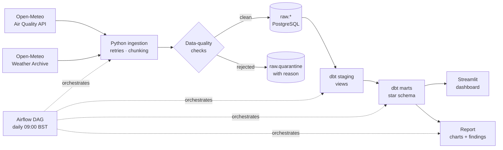
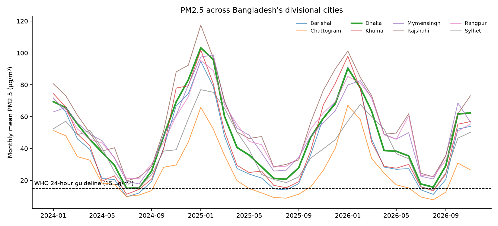
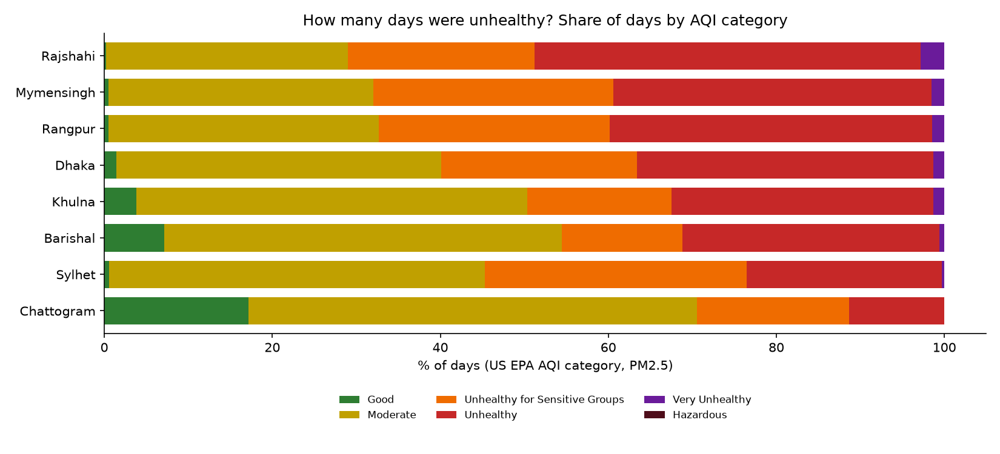
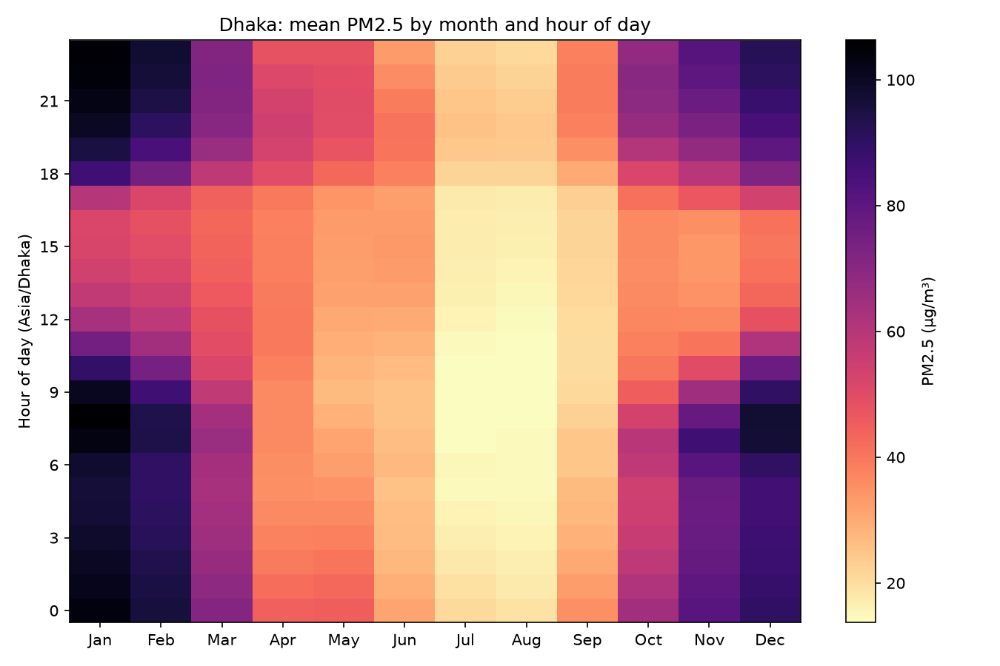
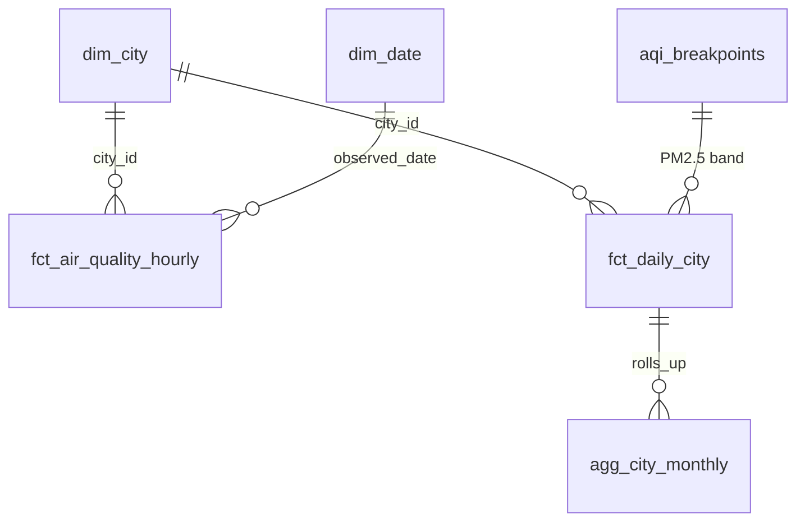

# Bangladesh Air-Quality ELT Pipeline

[](https://github.com/abed101-glitch/bd-air-quality-pipeline/actions/workflows/ci.yml)

An end-to-end data engineering project: hourly air-pollution and weather data for Bangladesh's
eight divisional cities is ingested from public APIs, validated, loaded into **PostgreSQL**,
modelled into a **star schema with dbt** (35 data tests), orchestrated daily by **Apache Airflow**,
and served through a **Streamlit** dashboard and an automated analysis report.

**Stack:** Python · pandas · PostgreSQL · dbt · Apache Airflow 3 · Streamlit · matplotlib · pytest · GitHub Actions



## What the data shows (Jan 2024 – Nov 2026, 8,392 complete city-days)



- **Dhaka's average PM2.5 was 48.2 µg/m³, 9.6× the WHO annual guideline** (5 µg/m³).
- **88% of days in Dhaka exceeded the WHO 24-hour limit**, and **36.6% were "Unhealthy" or worse** on the US EPA AQI.
- **Winter is 3.5× worse than monsoon** in Dhaka. Every city follows the same cycle, peaking in January.
- **Rajshahi, not Dhaka, had the highest average PM2.5** (57.5 µg/m³). **Chattogram had the lowest** (27.2), which fits its coastal winds.



- In Dhaka, pollution **peaks late at night (~22:00) and again in the winter morning rush (07:00–09:00)**,
  and is lowest mid-afternoon, when the atmosphere mixes the most:



All numbers are generated by [`analysis/make_report.py`](analysis/make_report.py) and saved to
[`docs/findings.json`](docs/findings.json) on every pipeline run.

> **Data caveat:** Open-Meteo air-quality values come from the Copernicus CAMS atmospheric model,
> not ground monitors. They are well suited to comparing cities and seasons, but they are estimates, and
> absolute values can differ from local station readings.

## Engineering highlights

| Area | What it does |
|---|---|
| **Ingestion** | Date-chunked requests for all 8 cities per call, with exponential backoff on 429/5xx. Bulk load uses `COPY` into a temp table, then `INSERT … ON CONFLICT DO UPDATE`, so re-runs are idempotent. |
| **Incremental loads** | Each run re-pulls a 7-day lookback window so revised API values are corrected. Each source loads in its own transaction, so a failure never leaves a half-loaded window. |
| **Data quality** | Negative values, physically impossible values, duplicate keys and missing keys are **quarantined with a reason, never silently dropped**. Hours the API hasn't published yet are counted separately as *unavailable*. Every run writes received / loaded / quarantined counts to `raw.load_log`. |
| **Modelling (dbt)** | Staging views → star schema: `dim_city`, `dim_date` (Bangladesh seasons, Fri/Sat weekend), incremental `fct_air_quality_hourly` (pollutants joined to weather), `fct_daily_city`, `agg_city_monthly`. |
| **AQI logic** | US EPA 2024 PM2.5 breakpoints are stored as a **seed table** and joined, not hard-coded. AQI uses the 24-hour mean truncated to 0.1 µg/m³ and is only reported for days with ≥ 75% hourly completeness. |
| **Testing** | **35 dbt data tests** (uniqueness, referential integrity, accepted values, ranges, source freshness, 3 custom SQL assertions) plus **29 pytest tests**. One integration test checks the SQL AQI against an independent Python implementation on every scored day. It caught a real truncation-vs-rounding bug during development. |
| **Orchestration** | Airflow 3 DAG: `ingest → source freshness → seed → dbt build → report`, with retries and exponential backoff. Airflow runs in its own virtualenv so its dependency pins never clash with dbt's. |
| **CI** | GitHub Actions spins up Postgres 16, then runs lint, unit tests, a live one-week ingest, and the full `dbt build` on every push. |

## Data model



## Run it

Requires PostgreSQL 16 and [uv](https://github.com/astral-sh/uv).

```bash
createdb bd_air
make setup          # project virtualenv
make backfill       # ~200k rows per source, 2024-01-01 .. yesterday (about 30 s)
make dbt            # seeds + models + 35 data tests
make test           # 29 unit / integration tests
make report         # charts + docs/findings.json
make dashboard      # http://localhost:8501

make airflow-setup  # separate virtualenv for Airflow
make airflow        # Airflow UI on http://localhost:8080 with the daily DAG
```

Connection settings are read from environment variables (see `.env.example`).

## Repository layout

```
src/bdair/        extract · quality · load · pipeline (CLI) · aqi (reference implementation)
dbt/              models/staging · models/marts · seeds · macros (generic tests) · tests (SQL assertions)
dags/             Airflow DAG
dashboard/        Streamlit app
analysis/         report generator
tests/            pytest suite
```

## Data sources

- [Open-Meteo Air Quality API](https://open-meteo.com/en/docs/air-quality-api) (CAMS global model), CC BY 4.0
- [Open-Meteo Historical Weather API](https://open-meteo.com/en/docs/historical-weather-api) (ERA5), CC BY 4.0
- AQI breakpoints: US EPA, PM2.5 NAAQS revision (2024). Guideline values: WHO Global Air Quality Guidelines (2021).
